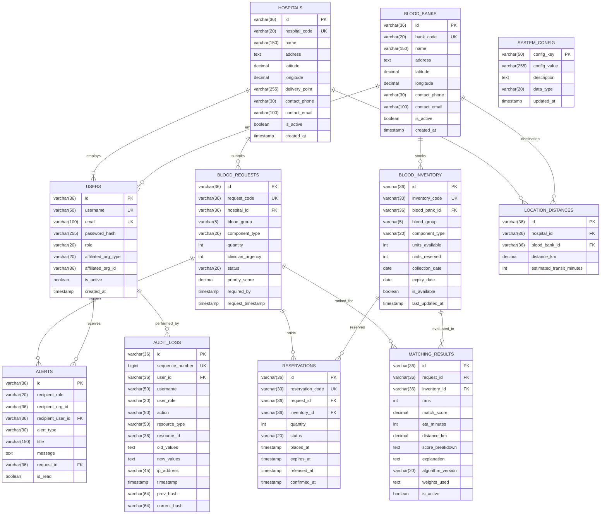
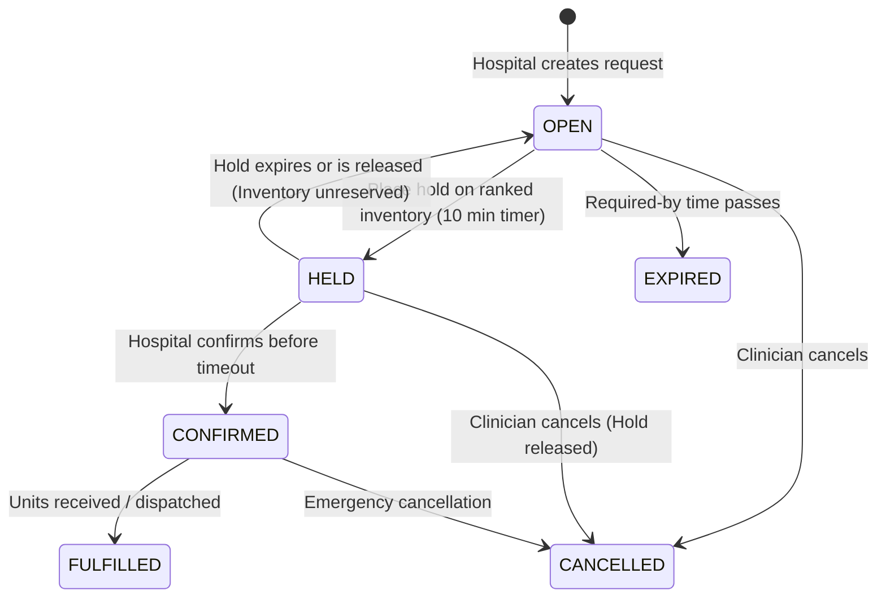

# Blood Bridge: Enterprise Database Design Document
**IBM Z Datathon 2026 · AI Secured Track (Innovation without Exposure)**  
**Version:** 1.0 (Production & Hackathon Delivery)  
**Target Systems:** Local PostgreSQL (Docker/Laptop) & IBM LinuxONE / IBM Db2 LUW  

---

## 1. Architectural Overview & Privacy Mandate

Blood Bridge is a privacy-first AI coordination layer that matches emergency blood requests from hospitals to available inventory at blood banks.

### The Privacy Guarantees (Zero-Exposure)
1. **Zero Patient Identifiers (`NFR-P1`, `FR-08`)**: The database schema strictly forbids patient names, social security / Aadhaar numbers, clinical histories, room numbers, or diagnoses.
2. **Zero Donor Identifiers (`NFR-P1`, `FR-21`)**: Inventory records represent pure anonymous inventory metadata (blood group, component, available units, expiry date). No donor identities, contact information, or health records are ever captured.
3. **Pseudonymous Request Codes (`NFR-P2`, `FR-08`)**: Request codes use `REQ_` + random alphanumeric suffix (e.g. `REQ_98A2F1`). Sequential counters are forbidden to avoid leaking emergency admission volume or timing patterns.
4. **Staged Disclosure (`NFR-P7`)**: While requests are in matching or held states, blood banks only see blood group, component, units, and required-by time. Only **after** a hospital confirms the match does the system disclose hospital name, delivery bay, and emergency contact details for physical dispatch.
5. **Immutable Audit Trail (`NFR-P5`, `FR-20`, `FR-46`)**: `audit_logs` is strictly append-only. A database trigger and cryptographic SHA-256 hash chaining prevent and expose any record tampering.

---

## 2. Entity-Relationship Diagram (ERD)

---

## 3. Data Dictionary

### 1. `system_config`
Stores non-hardcoded weights, thresholds, and operational rules (PRD 6.3, FR-11).
- `config_key` (`VARCHAR(50)`, PK): Configuration parameter key (e.g. `max_eta_minutes`, `hold_timeout_minutes`).
- `config_value` (`VARCHAR(255)`, NOT NULL): Current parameter value.
- `description` (`TEXT`): Human explanation of rule.
- `data_type` (`VARCHAR(20)`, CHECK): `string`, `integer`, `float`, `boolean`, `json`.
- `updated_at` (`TIMESTAMPTZ`, NOT NULL): Timestamp of parameter revision.

### 2. `hospitals`
Registered medical facilities requesting emergency units.
- `id` (`VARCHAR(36)`, PK): Universal 36-char UUID.
- `hospital_code` (`VARCHAR(20)`, UNIQUE): e.g. `HOSP_001`.
- `name` (`VARCHAR(150)`, NOT NULL): Hospital name.
- `address` (`TEXT`, NOT NULL): Street address.
- `latitude`, `longitude` (`DECIMAL(9,6)`, NOT NULL): Geographic coordinates.
- `delivery_point` (`VARCHAR(255)`, NOT NULL): Emergency dock / trauma intake point (subject to staged disclosure).
- `contact_phone`, `contact_email` (`VARCHAR`, NOT NULL): Clinician emergency contact desk.
- `is_active` (`BOOLEAN`, DEFAULT TRUE).

### 3. `blood_banks`
Blood storage and donor center facilities.
- `id` (`VARCHAR(36)`, PK): 36-char UUID.
- `bank_code` (`VARCHAR(20)`, UNIQUE): e.g. `BB_001`.
- `name` (`VARCHAR(150)`, NOT NULL): Facility name.
- `address` (`TEXT`, NOT NULL): Street address.
- `latitude`, `longitude` (`DECIMAL(9,6)`, NOT NULL): Geographic coordinates.
- `contact_phone`, `contact_email` (`VARCHAR`, NOT NULL): Dispatch desk.
- `is_active` (`BOOLEAN`, DEFAULT TRUE).

### 4. `users`
Authenticated clinicians, inventory managers, administrators, and compliance auditors.
- `id` (`VARCHAR(36)`, PK): 36-char UUID.
- `username` (`VARCHAR(50)`, UNIQUE, NOT NULL).
- `email` (`VARCHAR(100)`, UNIQUE, NOT NULL).
- `password_hash` (`VARCHAR(255)`, NOT NULL): Bcrypt or Argon2 hash.
- `role` (`VARCHAR(20)`, CHECK): `hospital_user`, `bloodbank_user`, `admin`, `auditor`.
- `affiliated_org_type` (`VARCHAR(20)`, CHECK): `hospital`, `blood_bank`, `none`.
- `affiliated_org_id` (`VARCHAR(36)`, NULLABLE): Links user to hospital or blood bank.
- `is_active` (`BOOLEAN`, DEFAULT TRUE).

### 5. `blood_inventory`
Anonymized blood units held by blood banks.
- `id` (`VARCHAR(36)`, PK): 36-char UUID.
- `inventory_code` (`VARCHAR(30)`, UNIQUE): e.g. `INV-202610-001`.
- `blood_bank_id` (`VARCHAR(36)`, FK `blood_banks.id`).
- `blood_group` (`VARCHAR(5)`, CHECK): `O+`, `O-`, `A+`, `A-`, `B+`, `B-`, `AB+`, `AB-`.
- `component_type` (`VARCHAR(20)`, CHECK): `Whole Blood`, `RBC`.
- `units_available` (`INTEGER`, >= 0).
- `units_reserved` (`INTEGER`, >= 0).
- `collection_date` (`DATE`, NOT NULL).
- `expiry_date` (`DATE`, NOT NULL): CHECK `expiry_date > collection_date`.
- `is_available` (`BOOLEAN`, DEFAULT TRUE).
- `last_updated_at` (`TIMESTAMPTZ`, NOT NULL).
- **Integrity Constraint**: `units_reserved <= units_available` (`FR-18`).

### 6. `blood_requests`
Hospitals' emergency requests.
- `id` (`VARCHAR(36)`, PK): 36-char UUID.
- `request_code` (`VARCHAR(30)`, UNIQUE): Pseudonymous code `REQ_` + random string (`NFR-P2`).
- `hospital_id` (`VARCHAR(36)`, FK `hospitals.id`).
- `blood_group` (`VARCHAR(5)`, CHECK): Valid blood group.
- `component_type` (`VARCHAR(20)`, CHECK): `Whole Blood`, `RBC`.
- `quantity` (`INTEGER`, > 0): Number of requested units.
- `clinician_urgency` (`INTEGER`, CHECK 1-5): 5 = immediate life threat, 1 = elective/routine.
- `status` (`VARCHAR(20)`, CHECK): `OPEN`, `HELD`, `CONFIRMED`, `CANCELLED`, `EXPIRED`, `FULFILLED`.
- `priority_score` (`DECIMAL(5,2)`, NULLABLE): Priority across competing requests.
- `required_by` (`TIMESTAMPTZ`, NOT NULL): Required arrival deadline.
- `request_timestamp` (`TIMESTAMPTZ`, DEFAULT NOW): Timestamp of submission.

### 7. `reservations`
Transactional holds preventing double allocation (PRD 8.4, 8.5).
- `id` (`VARCHAR(36)`, PK): 36-char UUID.
- `reservation_code` (`VARCHAR(30)`, UNIQUE): e.g. `RES_9A21B`.
- `request_id` (`VARCHAR(36)`, FK `blood_requests.id`).
- `inventory_id` (`VARCHAR(36)`, FK `blood_inventory.id`).
- `quantity` (`INTEGER`, > 0).
- `status` (`VARCHAR(20)`, CHECK): `ACTIVE`, `CONFIRMED`, `RELEASED`, `EXPIRED`.
- `placed_at` (`TIMESTAMPTZ`, DEFAULT NOW).
- `expires_at` (`TIMESTAMPTZ`, NOT NULL): Defaults to +10 minutes from placement.
- `released_at`, `confirmed_at` (`TIMESTAMPTZ`, NULLABLE).

### 8. `matching_results`
Transparent ranking with score breakdown (PRD Section 7).
- `id` (`VARCHAR(36)`, PK): 36-char UUID.
- `request_id` (`VARCHAR(36)`, FK `blood_requests.id`).
- `inventory_id` (`VARCHAR(36)`, FK `blood_inventory.id`).
- `rank` (`INTEGER`, >= 1).
- `match_score` (`DECIMAL(5,2)`, 0.00-100.00).
- `eta_minutes` (`INTEGER`, >= 0).
- `distance_km` (`DECIMAL(6,2)`, >= 0).
- `score_breakdown` (`TEXT`): JSON breakdown of factor scores.
- `explanation` (`TEXT`): Human-readable justification.
- `algorithm_version` (`VARCHAR(20)`): e.g. `v1.0-secured`.
- `weights_used` (`TEXT`): JSON snapshot of weights used at match time.
- `is_active` (`BOOLEAN`, DEFAULT TRUE).

### 9. `alerts`
In-app notifications (PRD 6.5).
- `id` (`VARCHAR(36)`, PK): 36-char UUID.
- `recipient_role` (`VARCHAR(20)`, CHECK): `hospital_user`, `bloodbank_user`, `admin`, `auditor`.
- `recipient_org_id` (`VARCHAR(36)`, NULLABLE).
- `recipient_user_id` (`VARCHAR(36)`, FK `users.id`).
- `alert_type` (`VARCHAR(30)`, CHECK): `MATCH_FOUND`, `SHORTAGE_DETECTED`, `MATCH_EXPIRED`, `ALLOCATED`.
- `title` (`VARCHAR(150)`), `message` (`TEXT`).
- `request_id` (`VARCHAR(36)`, FK `blood_requests.id`).
- `is_read` (`BOOLEAN`, DEFAULT FALSE).

### 10. `location_distances`
Precomputed distance and transit time between each hospital and blood bank.
- `id` (`VARCHAR(36)`, PK): 36-char UUID.
- `hospital_id` (`VARCHAR(36)`, FK `hospitals.id`).
- `blood_bank_id` (`VARCHAR(36)`, FK `blood_banks.id`).
- `distance_km` (`DECIMAL(6,2)`): Haversine distance.
- `estimated_transit_minutes` (`INTEGER`): Estimated road delivery duration.
- **Constraint**: `UNIQUE (hospital_id, blood_bank_id)`.

### 11. `audit_logs`
Immutable append-only audit trail with tamper-evident cryptographic hash chain.
- `id` (`VARCHAR(36)`, PK): 36-char UUID.
- `sequence_number` (`BIGINT GENERATED ALWAYS AS IDENTITY`, UNIQUE).
- `user_id` (`VARCHAR(36)`, FK `users.id`).
- `username` (`VARCHAR(50)`), `user_role` (`VARCHAR(20)`).
- `action` (`VARCHAR(50)`): e.g. `CREATE_REQUEST`, `PLACE_HOLD`, `CONFIRM_HOLD`.
- `resource_type` (`VARCHAR(50)`), `resource_id` (`VARCHAR(36)`).
- `old_values`, `new_values` (`TEXT`): JSON payloads with masked PII.
- `ip_address` (`VARCHAR(45)`): IPv4 / IPv6 stored as text for cross-platform Db2 support.
- `timestamp` (`TIMESTAMPTZ`, DEFAULT NOW).
- `prev_hash` (`VARCHAR(64)`): SHA-256 hash of previous row.
- `current_hash` (`VARCHAR(64)`): SHA-256 hash of this record.
- **Database Trigger**: Block all `UPDATE` and `DELETE` operations.

---

## 4. State Machine & Request Lifecycle

---

## 5. Scoring & Matching Engine Specification

1. **Phase 1: Deterministic Eligibility Filter**:
   - Blood group compatibility (ABO / Rh compatible).
   - Component type matches (`Whole Blood` or `RBC`).
   - Unreserved stock >= requested quantity (`units_available - units_reserved >= quantity`).
   - Expiry check (`expiry_date > CURRENT_DATE`).
   - Active status (`is_available = TRUE`).
2. **Phase 2: Request Priority across Competing Requests**:
   - Competing requests sorted by `clinician_urgency DESC`, then `request_timestamp ASC` (earlier first), then `id ASC`.
3. **Phase 3: Supply Ranking per Request (0-100 Score)**:
   - **ETA (Max 50 pts)**: `(1 - eta_minutes / 180) * 50`; 0 pts if >= 180 mins.
   - **Expiry Suitability (Max 30 pts, FIFO)**:
     - <= 3 days: 30 pts
     - <= 7 days: 25 pts
     - <= 30 days: 15 pts
     - > 30 days: 5 pts
   - **Data Freshness (Max 20 pts)**:
     - Updated <= 1h ago: 20 pts
     - Updated <= 6h ago: 10 pts
     - Updated <= 24h ago: 5 pts
     - Older: 0 pts
4. **Phase 5: Shortage Handling**:
   - 0 eligible units -> `COMPLETE shortage alert`.
   - Best score < 50.0 -> `PARTIAL shortage alert`.
